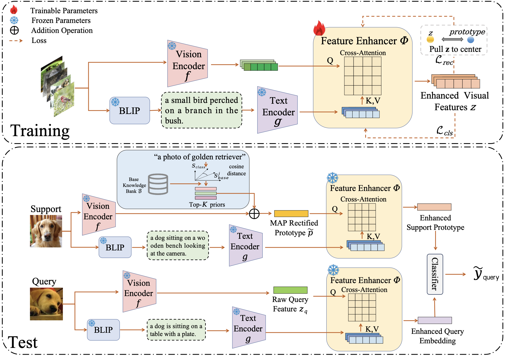

<!-- <p align="center">
  <h1 align="center">PMCE: Probabilistic Multi-Granularity Semantics with Caption-Guided Enhancement for Few-Shot Learning</h1>
</p> -->
# [IJCAI2026] PMCE: Probabilistic Multi-Granularity Semantics with Caption-Guided Enhancement for Few-Shot Learning

This is the official pytorch implementation of IJCAI 2026 paper ["PMCE: Probabilistic Multi-Granularity Semantics with Caption-Guided Enhancement for Few-Shot Learning"] [[paper]]() [[ArXiv]](https://arxiv.org/abs/2601.14111).

<p align="center">
  
</p>

## 🌟 Highlights

### Key Contributions:

**Method Side:**

- **PMCE Framework:** PMCE introduces probabilistic multi-granularity semantics for few-shot learning, using caption-guided enhancement to improve both support and query representations.
- **Caption-Guided Dual-Stream Enhancement:** Instance captions are generated by BLIP and encoded by CLIP as label-free semantic cues. A cross-attention based feature enhancer then integrates visual and textual information.
- **Semantics-Guided Prior Selection:** PMCE uses semantic cues to select Top-K base-class priors and calibrate support prototypes with MAP-based prototype calibration.
<!-- **Implementation Side:**

- This repository provides the PMCE version using **a single sentence embedding** (`1×512`) for image captions, which is the primary setting reported in the paper.
- The sentence-level implementation is provided as the default release because it offers an efficient balance between performance, storage cost, and GPU memory usage. -->
**Benchmarking Side:**

- PMCE supports standard few-shot benchmarks including **MiniImageNet**, **TieredImageNet**, **CIFAR-FS**, and **FC100**.
- The implementation supports both **ResNet12** and **Swin-Tiny** backbones, with pretrained weights, semantic features, and base priors available for reproducible experiments.

## 🔍 Sentence-Level vs. Token-Level Caption Semantics

This repository provides the sentence-level implementation rather than the token-level version due to the following practical considerations:

- **Storage and Memory Constraints:** Token-level features (`77×512` per image) generate massive semantic files. For large-scale datasets such as *TieredImageNet*, the storage requirement can reach several GBs per split.
- **Computational Efficiency:** Token-level semantics significantly increase inference latency and GPU memory usage because the cross-attention module must process much longer sequences, especially when concatenating support tokens in multi-shot scenarios.

Our evaluations on *MiniImageNet* with Swin-Tiny under the 1-shot setting show that both settings provide consistent benefits, while the sentence-level version is substantially more practical.

| Strategy | Token-level | Sentence-level |
| :--- | :---: | :---: |
| baseline | 71.02% | 71.02% |
| baseline+Enh.(Support) | 72.20% | 72.18% |
| baseline+Enh.(Query) | 72.73% | 72.49% |
| baseline+Enh.(Support+Query) | 79.64% | 79.42% |
| baseline+MAP | 74.93% | 74.93% |
| baseline+MAP+Enh.(Support) | 75.50% | 74.99% |
| baseline+MAP+Enh.(Query) | 77.12% | 77.17% |
| **baseline+MAP+Enh.(Support+Query)** | **85.29** | **85.03** |

---

## 📖 Table of Contents

- [Installation](#%EF%B8%8F-installation)
- [Data Preparation](#-data-preparation)
- [Vision-Language Models Preparation](#-vision-language-models-preparation)
- [Pretrained Weights and Semantic Files](#-pretrained-weights-and-semantic-files)
- [Start](#-start)
- [Evaluation](#-evaluation)

---

## 🛠️ Installation

### Requirements

Install the required dependencies under the project root:

```bash
cd PMCE
pip install -r requirements.txt
```

## 📦 Data Preparation

Prepare the following few-shot learning benchmarks:

- MiniImageNet
- TieredImageNet
- CIFAR-FS
- FC100

Download the datasets from [Google Cloud](https://drive.google.com/drive/folders/1P4oXDDcmipx_pqZO6izhIGYiPM4wD0_Q?usp=drive_link), then modify the corresponding dataset paths on your machine.

### TieredImageNet Versions

We use two publicly available versions of the TieredImageNet dataset with different data representations.

- **Image-based version:** The image-level TieredImageNet dataset is available at [TieredImagenet](https://drive.usercontent.google.com/download?id=1c9IaoKPXVH_56c-0UWZRZPICyQ1hlkMD&export=download&authuser=0). This version stores samples as raw images organized by class and is used for experiments with transformer-based backbones such as Swin Transformer.
- **Serialized version:** A serialized version of TieredImageNet, such as `.pkl` files, is available at [Google Cloud](https://drive.google.com/drive/folders/1P4oXDDcmipx_pqZO6izhIGYiPM4wD0_Q?usp=drive_link). For convenience, we place the serialized files on cloud storage for direct access in our experiments. This version is used for experiments with CNN-based backbones such as ResNet12.

Both versions follow the standard class split protocol of TieredImageNet and differ only in data representation.

## 🤖 Vision-Language Models Preparation

This project relies on two key pretrained vision-language models:

- **BLIP** for image caption generation: `Salesforce/blip-image-captioning-base`
- **CLIP** for visual/text semantic encoding: `openai/clip-vit-base-patch32`

### Online Mode

If your environment has internet access, the `transformers` library will automatically download and cache the models.

Modify the code in `build_caption_semantic.py` and set `local_files_only=False` in both `load_blip` and `load_clip`.

```bash
python build_caption_semantic.py \
  --blip_dir "Salesforce/blip-image-captioning-base" \
  --clip_dir "openai/clip-vit-base-patch32"
```

Downloaded models will be cached at:

```bash
~/.cache/huggingface/hub
```

### Offline Mode

If your server cannot access the internet, please download all model files in advance.

- [BLIP](https://huggingface.co/Salesforce/blip-image-captioning-base)
- [CLIP](https://huggingface.co/openai/clip-vit-base-patch32)

Keep the code unchanged, place all files in a local directory, and ensure:

```python
local_files_only=True
```

## 🎯 Pretrained Weights and Semantic Files

Pretrained backbone weights for **ResNet12** and **Swin-Tiny**, enhancer checkpoints, caption/class semantics extracted by CLIP, and pre-computed base priors can be downloaded from [Google Drive](https://drive.google.com/drive/folders/1cxFNFmIC90Ic2nLleTOyT_rpTzA1nGXn).

Please download the required files and place them under the project root directory before running experiments.

## 🔄 Start

Please execute the following commands in sequence.

### 1. Compute Base-Class Priors

Compute class means for each dataset. Alternatively, you can use the files we have already provided.

```bash
python compute_center.py \
  --dataset MiniImageNet/TieredImageNet/CIFAR-FS/FC100 \
  --backbone resnet/swin
```

### 2. Prepare Semantic Features

Generate semantic features for train/val/test splits, or download the provided files from [Google Drive](https://drive.google.com/drive/folders/1cxFNFmIC90Ic2nLleTOyT_rpTzA1nGXn).

```bash
python build_caption_semantic.py \
  --dataset_root /path/to/your/datasets/MiniImageNet/train \
  --imagenet_index_json ./imagenet_class_index.json \
  --blip_dir /path/to/your/offline_models/blip-image-captioning-base \
  --clip_dir /path/to/your/offline_models/clip-vit-base-patch32 \
  --dataset MiniImageNet \
  --split train \
  --mode clip \
  --text_type caption \
  --output_dir ./semantic \
  --clsname_source imagenet_index
```

### 3. Train the Enhancer

You may either train the enhancer or use the provided pretrained weights.

```bash
python method/train.py \
  --backbone swin \
  --mode clip \
  --text_type caption \
  --feat-size 768 \
  --semantic-size 512 \
  --sem_kind imgsem
```

## 📊 Evaluation

### 1-Shot Evaluation

```bash
python method/test.py \
  --use_enhancer \
  --shot 1 \
  --backbone resnet/swin \
  --dataset MiniImageNet/TieredImageNet/CIFAR-FS/FC100 \
  --map_estimate_cov true \
  --map_alpha 0.33 \
  --map_topk 7
```

### 5-Shot Evaluation

```bash
python method/test.py \
  --use_enhancer \
  --shot 5 \
  --backbone resnet/swin \
  --dataset MiniImageNet/TieredImageNet/CIFAR-FS/FC100 \
  --map_estimate_cov true \
  --map_alpha 0.7 \
  --map_topk 7
```

## 📝 Citation

If you find this work useful, please cite our paper. The BibTeX entry will be updated after the official citation information is available.

## Acknowledgement

This repository uses BLIP for image caption generation and CLIP for visual/text semantic encoding. Many thanks to the authors and contributors of these open-source projects.

We are thankful to the following open-source repositories, which provided essential components and functional tools for our study.

- [SemFew](https://github.com/zhangdoudou123/SemFew)

- [FewTURE](https://github.com/mrkshllr/FewTURE)


